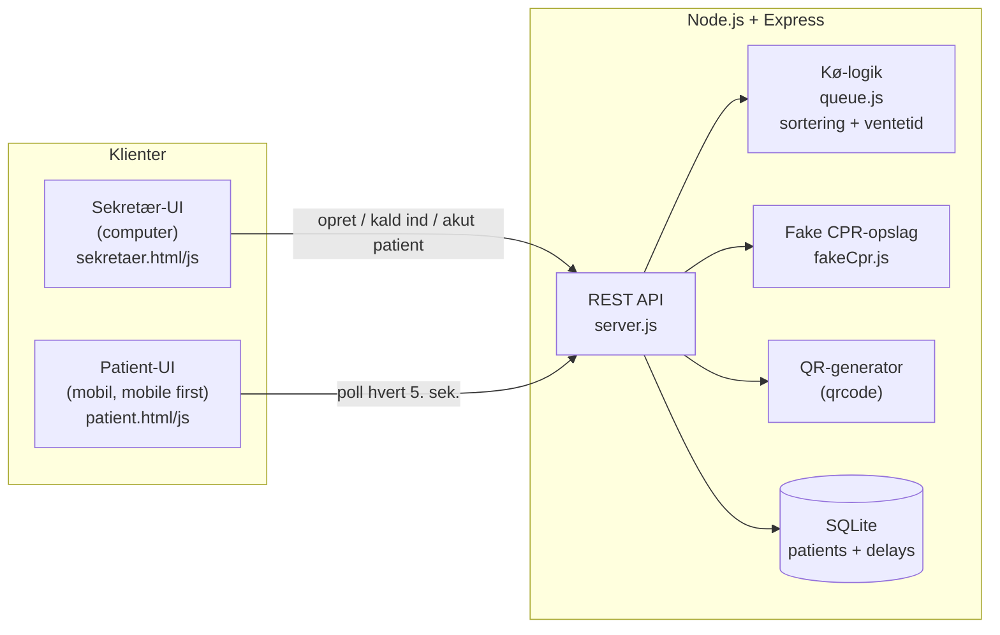
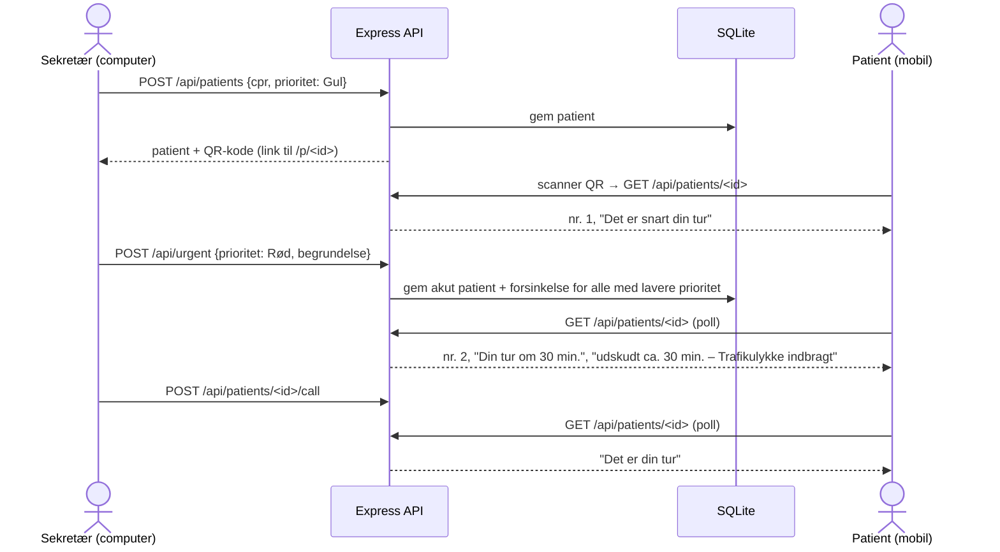

# Arkitektur – Skadestuekø

## Komponenter

| Komponent | Ansvar |
|---|---|
| **Sekretær-UI** | Opretter patienter, viser QR-kode, viser køen, kalder ind, tilføjer akut patient med begrundelse. |
| **Patient-UI** | Viser plads i køen, forventet ventetid, forsinkelse + begrundelse og "Det er din tur". Opdaterer sig selv hvert 5. sekund. |
| **REST API** | `POST /api/patients`, `GET /api/patients`, `GET /api/patients/:id`, `GET /api/patients/:id/qr`, `POST /api/patients/:id/call`, `POST /api/urgent`, `GET /api/priorities` |
| **Kø-logik** | Sorterer efter triage-prioritet (Rød → Blå) og derefter ankomst. Hver prioritet har en behandlingstid. Den forrestes tid tæller ned i realtid; ventetid = resterende tid for den forreste + fulde tider for de øvrige foran. Bliver den forreste skubbet af en akut patient, gemmes den tid der allerede er brugt. |
| **Fake CPR** | Validerer formatet og giver et opdigtet navn. Der slås ikke noget op. |
| **SQLite** | `patients` (id, cpr, navn, prioritet, ankomst, status, sidst viste ventetid, aktuel forsinkelse) og `delays` (patient, minutter, begrundelse, tidspunkt). |

**Patientens visning:** Forventet tidspunkt (nu + ventetid) rundet til nærmeste kvarter, plus en nedtælling "Din tur om N min.", der tæller ned minut for minut. Når den rammer 0, vises "Det er snart din tur", indtil sekretæren kalder ind.

**Forsinkelser:** Hver gang patienten åbner/opdaterer sin side, sammenlignes det forventede tidspunkt med det sidst viste. Bliver det mindst 1 min. senere, og er der kommet en mere akut patient siden sidst, vises "udskudt med N min." med den seneste begrundelse. Bliver det tidligere (fx når den akutte patient er kaldt ind), forsvinder beskeden. At tiden bare løber over (sekretæren har ikke kaldt ind endnu), tæller ikke som en forsinkelse. Første visning viser aldrig en forsinkelse.

## Dataflow: en akut patient skubber en testperson

## Realiseret vs. designforslag

| Realiseret i MVP'en | Designforslag (ikke bygget) |
|---|---|
| Kø med triage-prioritet og beregnet ventetid | Rigtigt opslag i CPR-registret |
| QR-kode til patientens egen side | Hardware-enhed med lille skærm til patienter uden smartphone |
| Live-opdatering (polling hvert 5. sek.) | Push-notifikation/vibration når det er tæt på ens tur |
| Forsinkelse + begrundelse til patienten | Ventetidsestimat via telefon (1813) |
| Sekretær-side til opsætning og styring | Login/adgangskontrol for personale |
| | Behandlingstider baseret på rigtige data i stedet for faste estimater |
